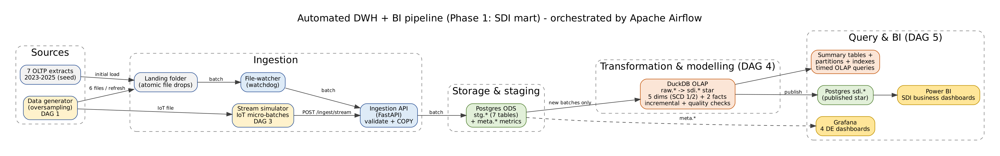
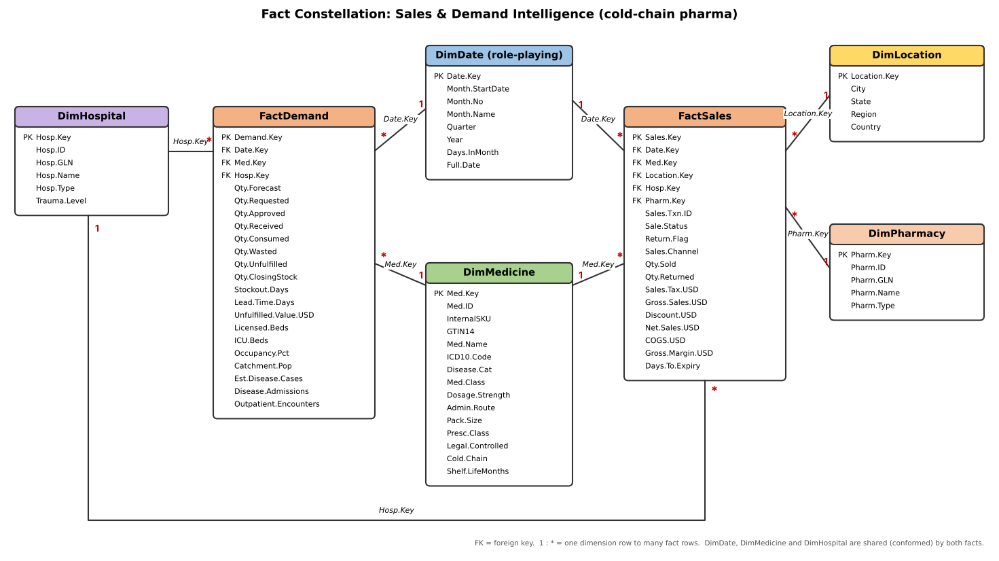

# Pharma Cold-Chain DWH - SDI Data Mart, Automated DWH + BI Pipeline (Phase 1)

Data Analytics and Warehousing, Fall 2026: an automated data-engineering pipeline for the
**pharmaceutical cold-chain supply chain** dataset. Phase 1 builds the **Sales & Demand
Intelligence (SDI)** data mart and its dashboards. Apache Airflow orchestrates every step.

| Deliverable | Where |
|---|---|
| Project report (max 5 pages) | `deliverables/Phase.1.Report.pdf` |
| SDI design workbook | `deliverables/SDI.Excel.xlsx` |
| Data-generation report | `deliverables/Data_Generation_Report.pdf` |
| Demo video | _link here_ |
| Group members | see below |

## Group members

| Name | ERP / ID | Role |
|---|---|---|
| _name_ | _id_ | _role_ |
| _name_ | _id_ | _role_ |
| _name_ | _id_ | _role_ |

## Architecture



```
generator ──► data/landing ──► file-watcher ──► FastAPI /ingest/batch ──► Postgres stg.* (ODS)
generator ──► data/stream  ──► stream simulator ──► FastAPI /ingest/stream ──┘        │
                                                                                      ▼
                         Power BI ◄── Postgres sdi.* ◄── publish ◄── DuckDB sdi.* star schema
                         Grafana  ◄── Postgres meta.* (batch, stream, storage, query metrics)
```

| Layer | Implementation |
|---|---|
| Data oversampling | `generator/generate.py`: seasonal bootstrap of one quarter per refresh for all 7 files |
| Batch ingestion | `ingestion/watcher.py` (watchdog) → `ingestion/api.py` (FastAPI) → `ingestion/loader.py` (validate + COPY) |
| Stream ingestion | `ingestion/stream_producer.py` → `POST /ingest/stream` (latency, throughput, malformed per window) |
| Storage & staging | PostgreSQL 16: `stg.*` (7 tables), `meta.*` (metrics), `sdi.*` (published star) |
| Transformation & modelling | DuckDB: `transform/run_sdi.py` + `transform/sql/sdi/*.sql` (SCD 1/2, incremental facts, summary tables, quality checks) |
| Query layer | `query/catalog.py` (16 OLAP queries), `query/run_queries.py` (timed, logged) |
| Monitoring | `monitoring/storage_metrics.py`, Grafana dashboards in `grafana/dashboards` |
| BI | Power BI on Postgres `sdi` schema (see `powerbi/README.md`) |
| Orchestration | `dags/` - master DAG + one DAG per layer |

## SDI data mart



Fact constellation (design in `deliverables/SDI.Excel.xlsx`):

* **fact_sales** - one row per sale (all 60 pharmacies: hospital, chain and independent, in-store and e-commerce)
* **fact_demand** - one row per hospital, medicine and month
* **Dimensions:** `dim_date` (role-playing: sales date / demand month), `dim_medicine` (SCD Type 1 + 2),
  `dim_location`, `dim_hospital` (row 0 = not a hospital pharmacy), `dim_pharmacy`
* **Summary tables for faster queries:** `agg_sales_month`, `agg_demand_vs_sales`, `agg_medicine_velocity`

Column names in the database are the Excel names in lower case with `_` (e.g. `Med.Key` → `med_key`, `Net.Sales.USD` → `net_sales_usd`).

## Run it

Prerequisites: Docker Desktop (4 GB+ RAM for Docker), and Power BI Desktop for the business dashboards.

```bash
git clone <repo> && cd pharma-dwh
# put the 7 source CSVs in data/seed/  (01_master_data.csv ... 07_iot_streaming_data.csv)
docker compose up -d --build          # first build takes a few minutes
```
On Linux, if Airflow cannot write to `data/` or `logs/`, run `sudo chmod -R 777 data logs`.

| Service | URL | Login |
|---|---|---|
| Airflow | http://localhost:8080 | admin / admin |
| Grafana | http://localhost:3000 | admin / admin |
| Ingestion API docs | http://localhost:8000/docs | - |
| Postgres (Power BI) | localhost:5432, db `pharma_dwh` | postgres / postgres |

In Airflow, trigger **`sdi_00_master_pipeline`** three times with the config:

1. `{"refresh": 0}`: historical load (2023-2025 seed files go through the watcher → API path)
2. `{"refresh": 1}`: generates and loads Jan-Mar 2026 (refresh 1)
3. `{"refresh": 2}`: generates and loads Apr-Jun 2026 (refresh 2)

After each run, press **Refresh** in Power BI; the Grafana dashboards update by themselves.

### Without Docker (local Postgres)

```bash
pip install -r requirements.txt
export PG_HOST=localhost PG_PASSWORD=postgres    # database "pharma_dwh" must exist
uvicorn ingestion.api:app --port 8000 &          # API
python -m ingestion.watcher &                    # watcher
cp data/seed/*.csv data/landing/                 # historical load
python -m transform.run_sdi --label historical
python -m generator.generate --refresh 1         # refresh 1 → landing + stream
python -m ingestion.stream_producer --eps 400
python -m transform.run_sdi --label refresh_1
python -m query.run_queries --label refresh_1 --inject-error
python -m monitoring.storage_metrics --label refresh_1
```

`python -m scripts.reset` wipes staging, metrics, the mart and the generator state so the demo can start again from zero.

## Repository layout

```
common/        config, source contracts (types + validation rules), Postgres helpers
generator/     data oversampling layer
ingestion/     loader, FastAPI ingestion API, file-watcher, stream simulator
transform/     DuckDB ELT driver + SQL for the SDI star schema
query/         OLAP query catalogue + timed runner
monitoring/    storage metrics
dags/          Airflow DAGs (master + 5 layer DAGs)
grafana/       datasource, dashboard provisioning, dashboard JSON (+ generator script)
powerbi/       Power BI model guide and DAX measures
sql/postgres/  ODS / metadata DDL
docker/        Dockerfiles and Postgres init
docs/          diagrams
deliverables/  report, SDI.Excel, data-generation report
```
